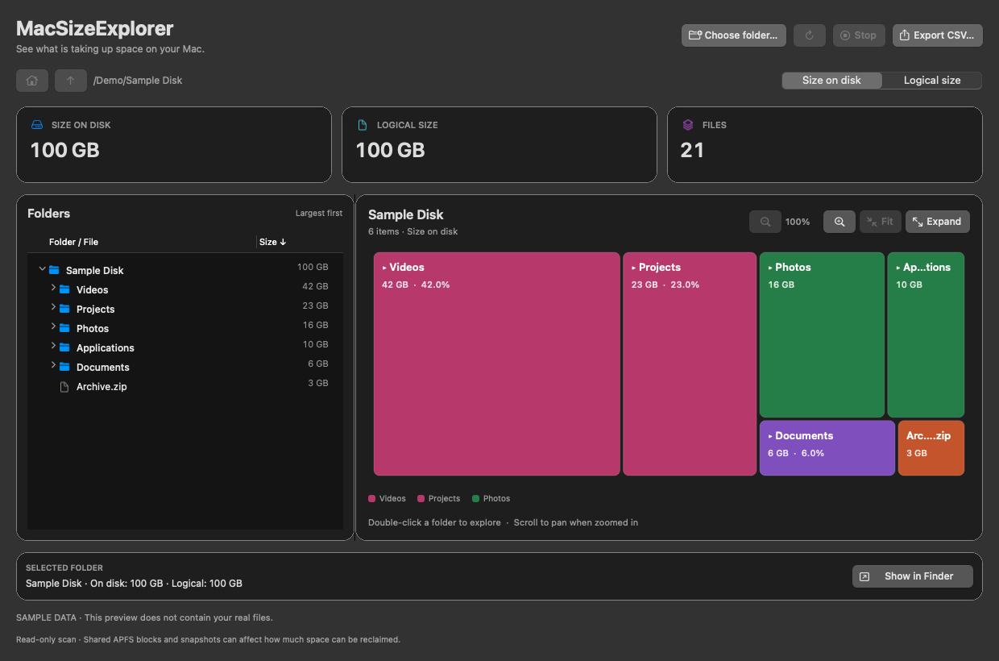

# MacSizeExplorer

A native, read-only disk usage analyzer for macOS, built with Swift and AppKit. Explore a folder tree and a proportional, zoomable disk map to find what is taking up space. No Python, web server, or external packages are required.

[ Türkçe kullanım kılavuzu ](README.tr.md)

## Download and install

**[Download MacSizeExplorer 1.2.0 — macOS Intel DMG](https://github.com/erhansenlik/MacSizeExplorer/raw/refs/heads/main/downloads/MacSizeExplorer-1.2.0-macOS-Intel.dmg)**

1. Open the DMG.
2. For English, drag **MacSizeExplorer.app** onto the **Applications** shortcut.
3. For Turkish, drag **MacSizeExplorer Türkçe.app** onto **Applications**. Both versions can be installed side by side.
4. Eject the disk image and open the installed app.

The downloadable apps require **macOS 13 or later and an Intel Mac**. They are ad hoc signed, not Apple Developer ID signed or notarized. macOS may require approval in **System Settings → Privacy & Security** before opening. You do not need to disable system security protections.

The DMG checksum is in [downloads/SHA256SUMS.txt](downloads/SHA256SUMS.txt). Apple Silicon users can build from source on their own Mac; the downloadable Intel build has not been tested on Apple Silicon.

## Interface



This preview uses synthetic data, not a scan of personal files.

## Explore your disk

- Click **Choose folder…** to select a folder or disk. Hidden files and application bundle contents are included.
- Expand folders in the tree using their disclosure arrows. Selecting a folder shows its immediate children in the map.
- Switch between **Size on disk** and **Logical size**. The tree is sorted from largest to smallest using the selected measure.
- Click a map tile to select an item; double-click a folder tile to explore it. Use the parent-folder or home buttons to navigate back.
- Click **Show in Finder** to reveal the selected item. The app does not delete or move files.
- Use **Rescan** (⌘R) after files change. Stopping a scan discards the incomplete result.
- **Export CSV…** saves paths, item types, allocated bytes, logical bytes, and file counts. Folder rows contain descendant totals: do not add folder and file rows together.

## Zoom and larger charts

- Use the magnifying glass **+ / −** buttons to zoom between **100% and 400%**. Trackpad pinch gestures are also supported.
- Scroll horizontally or vertically to pan around a zoomed map.
- **Fit** (⌘0) returns to the visible viewport.
- **Expand** (⌘2) opens a separate, resizable chart window with its own zoom controls.
- **⌘F** or the green window button switches the active window to full screen. **⌘+** and **⌘−** zoom its chart.
- Both windows follow the same folder and size measure; zoom levels are independent and reset when navigating to a different folder.
- Light and dark appearance follow macOS. The chart adapts to window resizing.

## Measurement details and limitations

- Access and read errors are counted in the status line. Unreadable contents are excluded, so totals may be incomplete. If needed, grant **Full Disk Access** in System Settings, then rescan.
- Symbolic links, sockets, devices, and other special files are not followed. Scanning does not cross onto another filesystem device; select that disk separately.
- Files with the same device and inode are counted once. Subsequent hard links show zero bytes but still count as file entries.
- Allocated size uses `st_blocks × 512`; logical size uses `st_size`. A directory's own metadata blocks are excluded.
- APFS clones may share blocks that are counted for multiple distinct files. Compression, snapshots, purgeable space, and filesystem metadata can also make totals differ from macOS storage reports or the space reclaimed by deleting an item.
- A scan is read-only but is not a filesystem snapshot. Concurrent file changes can affect results.
- The map draws the largest 600 immediate children separately and combines the rest into **Other items**. The tree and CSV retain all scanned entries. Colors are based on folder names or file extensions, not a global file-type summary.
- All scan results are held in memory; very large trees can use substantial memory.
- No network requests are made by the application. Scan results are not uploaded.
- Real file and folder names are preserved in both language versions. Built-in interface text is translated; system formatting follows macOS.

## Build from source

Install Apple's Xcode Command Line Tools, then run:

```sh
./build.command
./package-dmg.command
```

The first command builds both language variants from `Source/main.swift`. The same executable is used in both bundles; their `AppLanguage` metadata selects English or Turkish. The second command produces a compressed, read-only DMG containing both apps, an Applications shortcut, installation instructions, the MIT license, and third-party notices.

Builds target the architecture of the build machine. The repository download is the Intel build; a local Apple Silicon build produces an AppleSilicon-labeled DMG.

## Validation

```sh
./MacSizeExplorer.app/Contents/MacOS/MacSizeExplorer --self-test
./MacSizeExplorer.app/Contents/MacOS/MacSizeExplorer --ui-test /tmp/MacSizeExplorer-en-review
"./MacSizeExplorer Türkçe.app/Contents/MacOS/MacSizeExplorer" --ui-test /tmp/MacSizeExplorer-tr-review
```

Scanner tests cover nested byte totals, hard-link deduplication, symlink cycles, parent relationships, cancellation, and missing-path errors. UI tests use synthetic data to verify map proportions, aggregation, zoom limits, fit, separate-window navigation, size-mode synchronization, minimum window size, light/dark rendering, and language-specific controls and menus. UI tests briefly open application windows and save preview images.

Use `--demo` to explore the interface with synthetic data without scanning your files.

GitHub Actions builds both apps, runs the scanner tests, packages a DMG, and verifies its integrity. CI artifacts target the runner's architecture, which may differ from the Intel download in this repository.

## License

Licensed under the **MIT License**. See [LICENSE](LICENSE).
